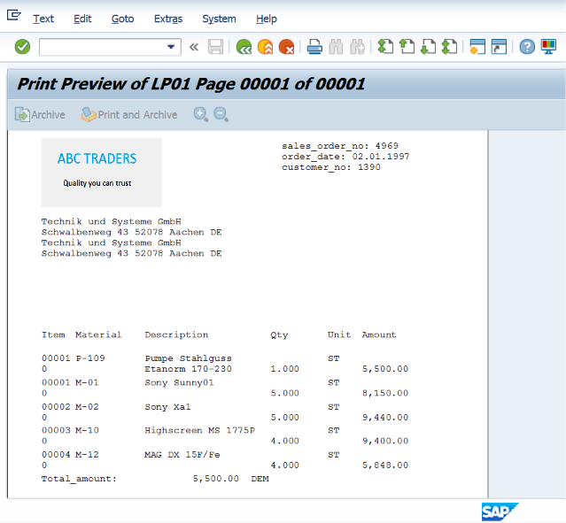
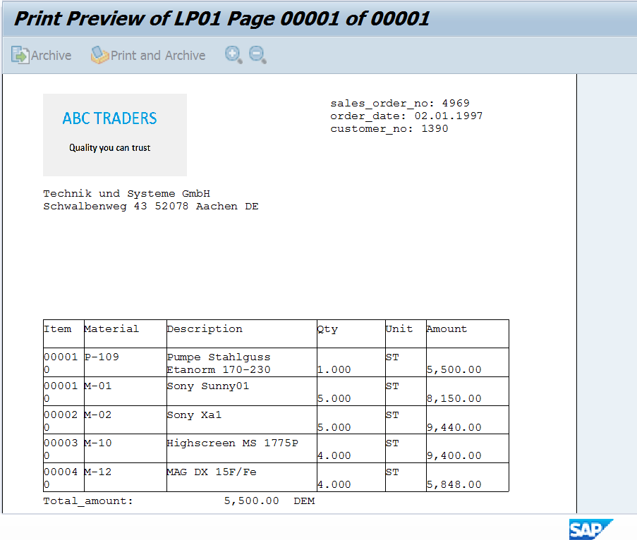
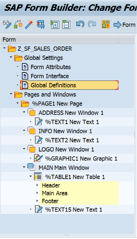
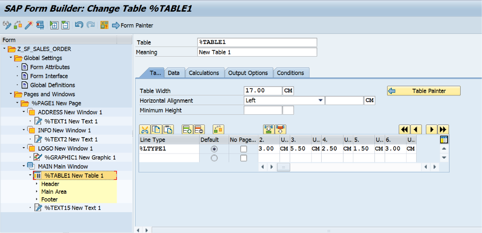
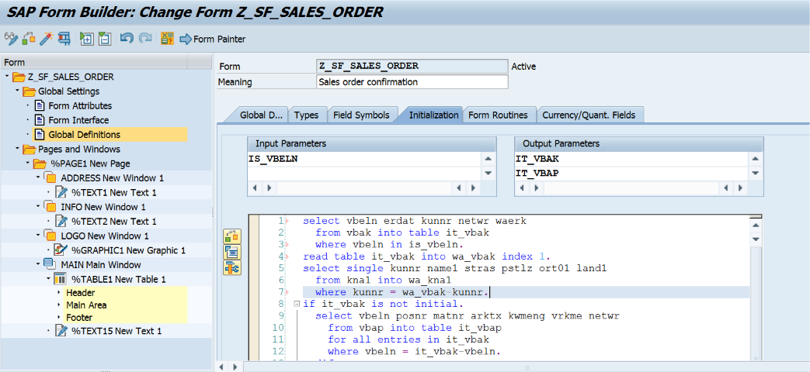

# Sales Order Confirmation Smart Form in SAP ABAP

A Smart Form that prints a sales order confirmation with a company logo, customer address, item table and order total. The user enters the sales order number on a selection screen, and the form fetches and prints the data.

## Concepts Covered

- Select-options passed from a driver program to a Smart Form (Tables parameter)
- Fetching data inside the form with a Program Lines node (Initialization tab)
- Global types, work areas and internal tables
- Customer address fetched from KNA1
- Company logo uploaded in SE78 and shown with a Graphic node
- Table node with line types for the item list
- Multiple windows (Main and Secondary) on one page

## Tables Used

| Table | Purpose | Fields used |
| VBAK | Sales order header | VBELN, ERDAT, KUNNR, NETWR, WAERK |
| VBAP | Sales order items | VBELN, POSNR, MATNR, ARKTX, KWMENG, VRKME, NETWR |
| KNA1 | Customer master (address) | KUNNR, NAME1, STRAS, PSTLZ, ORT01, LAND1 |

## How It Works

Selection screen (S_VBELN)
        |
Driver program (Z_SF_SALES_ORDER_DRV)
        |
Smart Form (Z_SF_SALES_ORDER)
        |
Initialization code reads VBAK -> KNA1 -> VBAP
        |
Windows print the logo, address, order info, item table and total

## Form Layout

| Window | Type | Content |
| LOGO | Secondary | Company logo (Graphic node) |
| INFO | Secondary | Order number, order date, customer number |
| ADDRESS | Secondary | Customer name and address |
| MAIN | Main | Item table and order total |

## Form Interface

| Tab | Parameter | Type | Reference |
| Tables | IS_VBELN | Type | ZTT_VBELN|

## Global Definitions

**Types:** 'TY_VBAK', 'TY_KNA1', 'TY_VBAP'

**Global data:**

| Variable | Type |
| WA_VBAK | TY_VBAK |
| IT_VBAK | TABLE OF TY_VBAK |
| WA_KNA1 | TY_KNA1 |
| WA_VBAP | TY_VBAP |
| IT_VBAP | TABLE OF TY_VBAP |

## Initialization Logic

**Input parameter:** 'IS_VBELN'
**Output parameters:** 'WA_VBAK', 'WA_KNA1', 'WA_VBAP', 'IT_VBAK', 'IT_VBAP'

```abap
select vbeln erdat kunnr netwr waerk
  from vbak into table it_vbak
  where vbeln in is_vbeln.

read table it_vbak into wa_vbak index 1.

select single kunnr name1 stras pstlz ort01 land1
  from kna1 into wa_kna1
  where kunnr = wa_vbak-kunnr.

if it_vbak is not initial.
  select vbeln posnr matnr arktx kwmeng vrkme netwr
    from vbap into table it_vbap
    for all entries in it_vbak
    where vbeln = it_vbak-vbeln.
endif.

## Driver Program

REPORT z_sf_sales_order_drv.

tables vbak.
select-options s_vbeln for vbak-vbeln.

CALL FUNCTION '/1BCDWB/SF000002xx'   "replace with your generated name
  TABLES
    is_vbeln = s_vbeln.

IF sy-subrc <> 0.
* Implement suitable error handling here
ENDIF.

> The generated function module name ('/1BCDWB/SF...') is different in every SAP system. Find yours in SMARTFORMS under Environment > Function Module Name.

## How to Run

1. Upload the logo in **SE78** (Form Graphics > BMAP) with your logo name.
2. Create or import the form 'Z_SF_SALES_ORDER' in SMARTFORMS and activate it.
3. Note the generated function module name.
4. Create the program 'Z_SF_SALES_ORDER_DRV' in SE38 and put that name in the 'CALL FUNCTION'.
5. Run the program, enter one sales order number in the **From** field and view the print preview.

## Screenshots

### Selection screen


### Output (page 1)


### Form tree


### Table line types


### Initialization code


## Limitations

- If a range of order numbers is entered, the header and customer address show only the first order, while the item table contains items of all orders in the range. Enter a single order number for correct output.
- The generated function module name is system specific.

## Tools

- SAP ECC 6.0 EHP 7
- Smart Forms (SMARTFORMS)
- ABAP (SE38, SE78, SE16N)

## Author

Amulya Radharapu